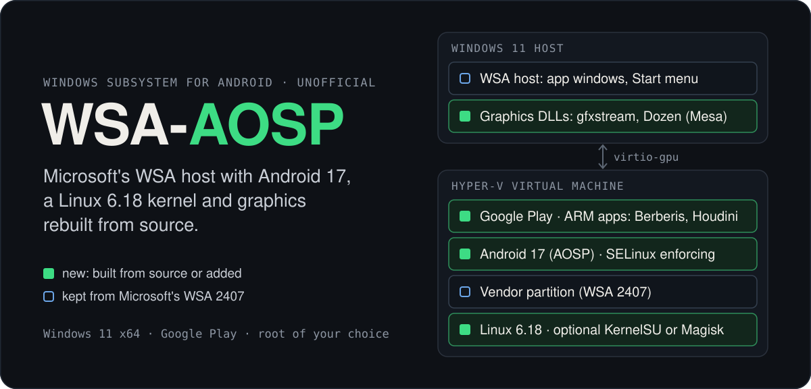
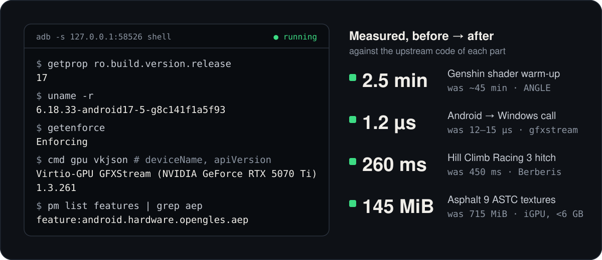

<p align="center">
  
</p>

<p align="center">
  <a href="https://github.com/Ognisty321/WSA-AOSP/releases"><b>Download</b></a> ·
  <a href="#install">Install</a> ·
  <a href="#variants">Variants</a> ·
  <a href="CHANGELOG.md">Changelog</a> ·
  <a href="#known-limitations">Limitations</a> ·
  <a href="https://github.com/Ognisty321/WSA-AOSP/issues">Report a problem</a>
</p>

<p align="center">
  <a href="https://github.com/Ognisty321/WSA-AOSP/releases"></a>
  <a href="https://github.com/Ognisty321/WSA-AOSP/releases"></a>
  
  
  
</p>

> [!WARNING]
> Unofficial test builds. Not affiliated with, endorsed or supported by Microsoft or Google.

Microsoft ended support for Windows Subsystem for Android on March 5, 2025. Its last version,
WSA 2407, runs Android 13. WSA-AOSP keeps Microsoft's Windows side of WSA (Android apps in their
own windows, Start menu entries, clipboard, notifications, shared folders) and its vendor
partition, and replaces Android, the kernel and the graphics libraries with builds from source.

<p align="center">
  
</p>

## What's inside

- **Android 17** built from AOSP (`android-17.0.0_r1`, build `CP2A.260605.016`): a `user` build
  signed with its own keys, SELinux enforcing, with the fixes of the Android security bulletins
  (each release names its patch level).
- **Linux 6.18** from the Android Common Kernel instead of Microsoft's 5.15, with the root you
  pick ([variants](#variants)): **SukiSU-Ultra**, **KernelSU** or **KernelSU-Next** built in, with
  **SuSFS** hiding the root from apps; **Magisk**, **Kitsune Mask** or **Magisk Alpha**; or none.
- **Graphics built from source.** gfxstream (upstream, with a layer for the WSA host) and Dozen
  from Mesa replace Microsoft's `gfxstream_backend.dll` and `vulkan_dzn.dll`, and Android's
  Vulkan driver comes from Mesa. Android gets **Vulkan 1.3** on the host GPU, and games get
  **OpenGL ES 3.2 with the Android Extension Pack** through ANGLE, so the Play Store offers games
  that need it, such as Genshin Impact.
- **Google Play services and the Play Store**, from Google's Android 17 emulator image.
- **ARM apps**: 64-bit ones through Berberis, Google's translator from the Android emulator
  image; 32-bit ones through Intel's Houdini 14.
- **`wsapad.exe`** maps keyboard and mouse to an Xbox, PlayStation or Switch controller for games
  that only take a pad, or to taps, a joystick and swipes on the screen for games that know only
  touch (it imports BlueStacks keymaps). Its window shows the controller, and you click a button
  to bind keys to it; F8 turns the mapping on and off.
- **WSA Tray**, an icon in the notification area that Microsoft's WSA does not have. It shows
  whether WSA runs, starts, restarts and turns it off, and opens your Android apps, Files, the
  Android settings and the WSA settings. It is an app of the WSA package and starts at sign-in.

## Compared with WSABuilds

[WSABuilds](https://github.com/MustardChef/WSABuilds) is Microsoft's WSA 2407.40000.4.0 with
Google Play (MindTheGapps) and, if you pick it, Magisk added. WSA-AOSP takes from WSA 2407 the
Windows host, the vendor partition, the initrd and Microsoft's own Android apps; Android, the
kernel and the two graphics DLLs are new.

| | WSABuilds | WSA-AOSP |
|---|---|---|
| Android | 13 (Microsoft) | **17** (AOSP) |
| Kernel | 5.15.104 (Microsoft) | **6.18** (Android Common Kernel) |
| Root | Magisk (KernelSU in older builds) | **SukiSU-Ultra, KernelSU, KernelSU-Next** (with SuSFS), **Magisk, Kitsune Mask, Magisk Alpha** |
| OpenGL ES | 3.0 | **3.2 + AEP** |
| Vulkan ("Vulkan driver" System Default / D3D12) | 1.3 / 1.1 | 1.3 / **1.2** |
| Host graphics DLLs | Microsoft's | gfxstream and Dozen built from source |
| ARM64 apps | Houdini (Intel Bridge Technology) | **Berberis** |
| Windows | 10 x64, 11 x64 and arm64 | 11 x64 only |
| Variants | seven per platform (with or without GApps, Magisk, Amazon Appstore) | eight, all with Google Play: one per root, and one without |

## Variants

Every build comes as one ZIP per root, with the same Android 17 and Google Play in each:

| `WSA-AOSP17_<build>_….zip` | Root | You install yourself, from the ZIP |
|---|---|---|
| `NoRoot` | none | nothing |
| `SukiSU-SUSFS` | SukiSU-Ultra with SuSFS | the SukiSU manager built for this port |
| `SukiSU` | SukiSU-Ultra | the manager of SukiSU-Ultra's release |
| `KernelSU-SUSFS` | KernelSU with SuSFS | the KernelSU manager and the SuSFS module |
| `KernelSU-Next-SUSFS` | KernelSU-Next with SuSFS | the KernelSU-Next manager and the SuSFS module |
| `Magisk` | Magisk | the Magisk app |
| `KitsuneMask` | Kitsune Mask | the Kitsune Mask app |
| `MagiskAlpha` | Magisk Alpha | the Magisk Alpha app |

SukiSU-Ultra, KernelSU and KernelSU-Next are built into the kernel, and SuSFS hides the root from
apps. Magisk and its forks start from `Tools\initrd.img` through a hook in the kernel, as WSA has
no boot image to patch. Not sure? Take `NoRoot`: you can change to another variant later
([Updating](#updating)). The `README.txt` of each ZIP names the exact versions and the steps for
its root.

## Install

### Requirements

- Windows 11, 64-bit (x64).
- 8 GB of RAM or more (16 GB recommended).
- CPU virtualization turned on in the BIOS/UEFI (Intel VT-x or AMD-V).
- About 2.7 GB for the extracted build, plus room for your Android apps and data.
- No WSA from the Microsoft Store: uninstall it first. A WSA in developer mode (for example from
  WSABuilds) is replaced: its Android data is backed up, and its folder stays where it is.

### Steps

1. Download the ZIP of your [variant](#variants) from
   [Releases](https://github.com/Ognisty321/WSA-AOSP/releases).
2. Extract it to a folder that stays, for example `C:\WSA`. WSA runs from there, so do not move
   or delete it later.
3. Turn on **Developer Mode** in **Settings > System > Advanced** (in Windows 11 without the
   September 2025 update: **For developers**, under System or Privacy & security).
4. Run `Run.bat` and allow administrator rights. It installs the frameworks from `Dependencies`,
   offers to turn on "Virtual Machine Platform" if it is off (then restart Windows and run it
   again), registers WSA and starts the WSA Tray icon. Log:
   `%LOCALAPPDATA%\WSA-AOSP17-backups\install.log`.
5. Start **Windows Subsystem for Android** from the Start menu or the tray icon. The first start
   takes longer. The Play Store and your Android apps then appear in the Start menu.

> [!TIP]
> To check the download, compare the output of `Get-FileHash .\WSA-AOSP17_*.zip` in PowerShell
> with the line of your ZIP in `WSA-AOSP17_<build>_SHA256SUMS.txt` from the same release.

> [!IMPORTANT]
> Vulkan 1.3 and OpenGL ES 3.2 need **Vulkan driver = System Default** in WSA Settings (under
> Experimental features); restart WSA after changing it. With D3D12, Android gets Vulkan 1.2 and
> OpenGL ES 3.0; with None, OpenGL ES 3.0 and no Vulkan.

### Updating

What each build changes is in the [changelog](CHANGELOG.md). Extract the new build to a new
folder, run `.\Run.bat -KeepData` in a terminal there to keep your apps and data, then delete the
old folder. Without `-KeepData` the installer backs up the Android data to
`%LOCALAPPDATA%\WSA-AOSP17-backups` and starts fresh, as it must when you come from Microsoft's
WSA or WSABuilds. Going back to an older build with the same data is not supported.

Another variant goes in the same way.

> [!CAUTION]
> Between two different roots, leave out `-KeepData`: the modules and settings of one root (in
> `/data/adb`) are not meant for another.

## adb

1. Turn on **WSA Settings > Advanced settings > Developer mode**.
2. Get [Android SDK Platform-Tools](https://developer.android.com/tools/releases/platform-tools).
3. Start any Android app, then run `adb connect 127.0.0.1:58526` and allow debugging in the
   Android window the first time.

## Google Play

Sign in to the Play Store with your Google account.

> [!NOTE]
> This Android is not certified by Google (Play Store > Settings > About > Play Protect
> certification: "Device is not certified"). If Google blocks the sign-in or the Play Store
> stops working, register the device once:
>
> 1. Read the GSF ID with [adb](#adb):
>    ```
>    adb shell "dumpsys activity service com.google.android.gms/.gcm.GcmService | grep DeviceID"
>    ```
> 2. Register that number with your Google account at <https://www.google.com/android/uncertified>.
> 3. Wait from a few minutes to a few hours, clear the data of the Play Store only (not of Google
>    Play services) and restart WSA.
>
> This is needed once per installation, and again only after the WSA data is cleared.

## Root

The app of the root is not preinstalled. Install it from the WSA folder with [adb](#adb), for
example `adb install "C:\WSA\Magisk-v31.1.apk"`; the `README.txt` there has the exact file names
and steps.

- **SukiSU-Ultra with SuSFS**: the manager shows "Working" and the SuSFS version. Use the one from
  the ZIP: its `ksud` supports SuSFS on x86_64 and the kernel trusts its signature; the stock
  manager from GitHub does not handle SuSFS here.
- **SukiSU-Ultra**: the stock manager of SukiSU-Ultra's release.
- **KernelSU or KernelSU-Next with SuSFS**: the manager from the ZIP, which upstream's CI built from
  the same commit as the kernel's driver (a manager that does not match asks for an update and
  hides Superuser and Modules). SuSFS's tool and settings come as `ksu_module_susfs-…-x86_64.zip`:
  `adb push` it to `/sdcard/Download` and install it under Modules.
- **Magisk, Kitsune Mask, Magisk Alpha**: on the first start the app asks for additional setup
  and restarts Android; then Zygisk can be turned on. Its Install and Uninstall buttons do not
  apply (there is no boot image); a newer version comes with a newer build of this port.

KPM modules of SukiSU-Ultra do not work on x86_64.

## Uninstall

**Settings > Apps > Installed apps > Windows Subsystem for Android > Uninstall**, then delete the
folder.

`Restore.bat` undoes the last install instead: it registers again the WSA folder that was
registered before, and puts back the Android data backup that install made in
`%LOCALAPPDATA%\WSA-AOSP17-backups`. An install with `-KeepData` makes no backup, so after one,
name the backup and the folder that belong together:
`.\Restore.bat -Backup <backup folder> -PreviousInstall <WSA folder>`.

## Known limitations

- Tested on one PC: AMD Ryzen 7 7800X3D with an NVIDIA GeForce RTX 5070 Ti. AMD and Intel GPUs
  and Intel CPUs should work but have not been checked.
- Windows 11 x64 only, and every variant has Google Play.
- Not certified by Google: apps and games that check Play Integrity may refuse to run or to log
  in (Pixel Gun 3D starts, but its server rejects the login).
- Apps from Microsoft's WSA or WSABuilds have to be installed again; their data stays in the
  backup.
- Task Manager may show a huge, growing "Dedicated GPU memory" for WsaClient. It is a quirk of how
  Windows counts shared textures; the real use is a few hundred MB.

## Reporting problems

Open an [issue](https://github.com/Ognisty321/WSA-AOSP/issues) with the build number (top of
`README.txt` in the WSA folder, or **About** in the tray menu, which copies the build info), your
Windows version, CPU and GPU, and what happened. Attach
`%LOCALAPPDATA%\WSA-AOSP17-backups\install.log` for installation problems and the output of
`adb logcat -d > logcat.txt` for problems in Android.

## Source code and licenses

The build system of this port is not public yet. Every release comes with
`WSA-AOSP17_<build>_GPL-sources.tar.xz`, the source of everything in its ZIPs under the GPL or
another copyleft license:

- the Linux kernels: the exact tree of the kernel without root, with the port's changes as
  patches, and for each root the patches that add its driver and SuSFS; the configuration of
  every kernel and the files that build them;
- each root at the commit its app was built from: SukiSU-Ultra (with the port's changes to its
  `ksud`), KernelSU or KernelSU-Next with the SuSFS module for x86_64, or Magisk, Kitsune Mask or
  Magisk Alpha with the program that starts it from the initrd;
- the copyleft projects of Android 17 in the images (libcore, e2fsprogs, iptables, ...), at the
  commits the images were built from.

<details>
<summary>Where each part comes from</summary>

| Part | Comes from | License |
|---|---|---|
| Windows host, initrd, vendor partition, Microsoft's Android apps | WSA 2407.40000.4.0 | Microsoft, proprietary |
| `dxil.dll` | Windows SDK | Microsoft, proprietary |
| Android 17 system | AOSP | Apache 2.0 and others (Android Settings > About > Legal information) |
| Linux kernel, kernel part of the root | Android Common Kernel, SukiSU-Ultra, KernelSU, KernelSU-Next | GPL-2.0 |
| SuSFS | susfs4ksu | GPL-3.0-or-later (the project's license) |
| Root managers, `ksud` | SukiSU-Ultra, KernelSU, KernelSU-Next | GPL-3.0-or-later |
| Magisk apps | Magisk, Kitsune Mask, Magisk Alpha | GPL-3.0 |
| `gfxstream_backend.dll` | gfxstream | Apache 2.0 (some parts MIT, BSD and other permissive licenses) |
| `vulkan_dzn.dll`, Android Vulkan driver | Mesa | MIT |
| ANGLE | ANGLE | BSD-3-Clause |
| Berberis (ARM64 translator) | Google's Android 17 emulator image | Apache 2.0 source; the image is under the Android SDK License Agreement |
| Google Play services, Play Store | Google's Android 17 emulator image | Google, proprietary (Android SDK License Agreement) |
| Houdini 14 (32-bit ARM translator) | Google Play Games Developer Emulator | Intel, proprietary |
| Shoulder, stick and D-pad icons in `wsapad.exe` | ControllerImage (art by Xelu, thoseawesomeguys) | CC0 (public domain) |

</details>

## Credits

- Microsoft for WSA.
- Google for AOSP, [gfxstream](https://android.googlesource.com/platform/hardware/google/gfxstream),
  [ANGLE](https://chromium.googlesource.com/angle/angle) and
  [Berberis](https://android.googlesource.com/platform/frameworks/libs/binary_translation).
- [Mesa](https://gitlab.freedesktop.org/mesa/mesa) for Dozen and the Vulkan driver of Android.
- For the root: [SukiSU-Ultra](https://github.com/SukiSU-Ultra/SukiSU-Ultra),
  [KernelSU](https://github.com/tiann/KernelSU),
  [KernelSU-Next](https://github.com/KernelSU-Next/KernelSU-Next) (with SuSFS by
  [pershoot](https://github.com/pershoot/KernelSU-Next)),
  [SuSFS](https://gitlab.com/simonpunk/susfs4ksu), [Magisk](https://github.com/topjohnwu/Magisk),
  [Kitsune Mask](https://github.com/Jordan231111/KitsuneMagisk) and
  [Magisk Alpha](https://github.com/vvb2060/Magisk).
- [ControllerImage](https://github.com/icculus/ControllerImage), Nicolae "Xelu" Berbece and Paul
  Paun ([thoseawesomeguys](https://thoseawesomeguys.com/prompts/)) for the shoulder, stick and
  D-pad icons of wsapad.
- [WSABuilds](https://github.com/MustardChef/WSABuilds) for keeping WSA builds coming after
  Microsoft stopped, and [MagiskOnWSALocal](https://github.com/LSPosed/MagiskOnWSALocal) for the
  tooling they are made with.
